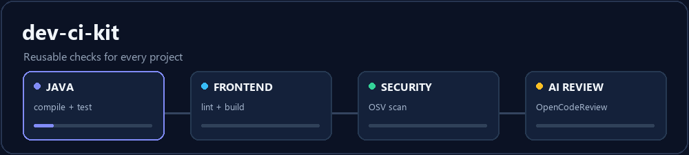
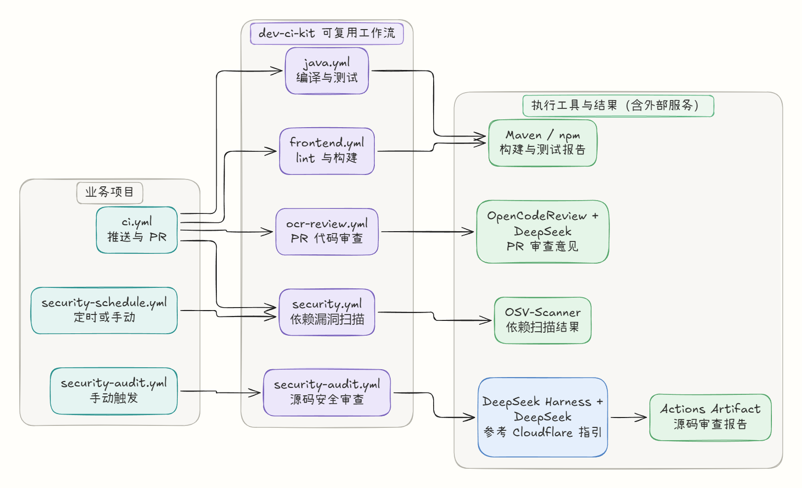
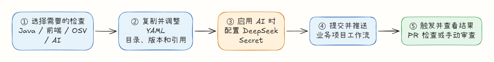

# dev-ci-kit



可复用的 GitHub Actions CI 工作流和 Codex Skill，帮助 Maven Java、npm 前端项目接入构建、测试、依赖漏洞扫描与 AI 代码审查。

## 项目架构



[查看可编辑的 Excalidraw 源文件](docs/assets/ci-architecture.excalidraw) · [查看 Mermaid 源文件](docs/assets/ci-architecture.mmd)

业务仓库中的 YAML 决定**何时触发、调用哪些工作流**；本仓库提供可复用的 YAML 定义，实际任务由 GitHub Actions runner 执行。业务仓库可按需选择任务；图中的定时扫描和手动源码审查都是可选接入。DeepSeek 是外部模型服务，Cloudflare 文件是审查指引，不是单独运行的审查程序。源码安全审查目前为实验性功能，使用前须确认引用的 `dev-ci-kit` 版本已经包含该工作流。

本仓库的 `validate.yml` 独立检查工具包自身的配置与测试，业务仓库不需要调用它。具体触发条件以业务仓库的工作流配置为准；OCR 仅在符合下文条件的 PR 中运行。

## 包含什么

| 工作流 | 默认行为 |
| --- | --- |
| `java.yml` | 使用 Java 17 编译并运行 Maven 测试，上传 Surefire 报告；优先使用项目的 Maven Wrapper。 |
| `frontend.yml` | 使用 Node.js 22 执行 `npm ci`、lint 和构建。 |
| `security.yml` | 使用 OSV-Scanner：PR 检查新增漏洞；其他事件全量扫描并报告，但默认不因已有漏洞失败。 |
| `ocr-review.yml` | 同仓库可信作者的非草稿 PR 使用 OpenCodeReview 和 DeepSeek 审查，并尝试在 PR 中发表意见。 |
| `security-audit.yml` | 实验性、手动触发的源码安全审查，参考 Cloudflare security-audit Skill 的指导模式；仅供私有仓库默认分支调用。 |

Java 测试是否需要数据库等服务取决于业务项目；本工具不会自动提供这些服务。报告仅包含 Maven Surefire 生成的文件；若没有生成文件则不会上传。安全扫描覆盖哪些依赖取决于 OSV 支持的清单和锁文件。AI 审查结果需要人工判断，运行成功也不代表没有漏洞或所有文件都被审查。

## 在业务仓库接入



[编辑配置流程图](docs/assets/ci-setup.excalidraw) · [查看 Mermaid 源文件](docs/assets/ci-setup.mmd)

仅启用 OCR 或源码安全审查时需要配置 DeepSeek Secret；源码安全审查还要求业务仓库为私有仓库，并从默认分支手动运行。具体配置如下。

### 1. 配置日常 CI

1. 根据项目实际情况，将 [Java + npm 前端示例](skills/dev-ci/assets/ci-java-react.yml)复制为业务仓库的 `.github/workflows/ci.yml`，并修改目录、版本和不需要的任务。示例的推送分支为 `main`。
2. Java 项目需要 Maven `pom.xml`、Java 17（或调整版本）和可运行的测试。前端需要 `package-lock.json` 以及 `lint`、`build` 脚本。可分别通过 `run-compile`、`run-tests`、`run-lint`、`run-build` 输入禁用步骤，但应先确认业务需要。
3. 如启用 OCR，在业务仓库 **Settings → Secrets and variables → Actions → Secrets** 中创建 `DEEPSEEK_API_KEY`，填入 DeepSeek API 密钥，不要提交密钥。组织级 secret 也可使用，但需要给该仓库授权。无需配置 `OCR_LLM_MODEL`，默认模型为 `deepseek-flash`，可通过 `model` 输入调整。
4. 提交到功能分支并创建 PR，在 Actions 和 PR 评论中检查结果。可另行使用[定时扫描示例](skills/dev-ci/assets/security-schedule.yml)，默认每周一 02:23 UTC 执行，也支持手动运行。

调用工作流须允许相应的 `GITHUB_TOKEN` 权限。示例已按任务声明：Java/前端只读仓库；OSV 工作流包含 `actions: read` 和 `security-events: write`；OCR 使用 `pull-requests: write` 发布评论。仓库或组织策略仍可能限制权限和第三方 Actions，需在真实运行中确认。

模板中的 `ci.yml` 在向 `main` 推送或创建、更新 PR 等事件时触发；OCR 只在符合条件的 PR 中运行。`security-schedule.yml` 需要另外复制到业务仓库的 `.github/workflows/` 才会按计划运行。模板本身位于 `skills/dev-ci/assets/`，不会自动触发。

### 2. 可选：启用手动源码安全审查

1. 确认业务仓库为**私有仓库**，并确认项目源码可以发送给 DeepSeek。此功能只支持从默认分支手动触发。
2. 将 [手动审查模板](skills/dev-ci/assets/security-audit-manual.yml)复制到业务仓库的 `.github/workflows/security-audit.yml`；仓库若已设置 `DEEPSEEK_API_KEY` 可复用，否则在 **Settings → Secrets and variables → Actions → Secrets** 中创建。不要把密钥提交到仓库。
3. 确认模板中 `uses` 引用的 `dev-ci-kit` 分支或提交已经包含 `security-audit.yml`，将业务仓库工作流提交到默认分支。示例使用 `@main`；如果功能还在测试分支，需要引用实际包含它的测试分支或提交。
4. 打开业务仓库 **Actions → Manual source security audit → Run workflow**，选择默认分支并运行。等待审查任务完成后，在该次运行的 **Artifacts** 下载 `security-audit-report-...`；报告默认保留 5 天。

运行链路是：业务仓库的手动工作流 → `dev-ci-kit` 的 `security-audit.yml` → 检出业务源码和 Cloudflare 指引 → 安装并启动 DeepSeek Harness → 生成报告。工作流通过提示词要求 Harness 参考 Cloudflare 指引，**不是强制执行完整六阶段审计**；结果仍须人工判断。非私有仓库、非默认分支或非手动事件会跳过审查任务，不能把跳过理解为审查通过。

## 接入 Codex Skill

将本仓库的 `skills/dev-ci` 安装为 Codex Skill，之后可在目标项目中要求 Codex 使用 `$dev-ci` 接入或检查 CI。安装后如果 Codex 没有发现新 Skill，重启 Codex 或开启新会话。Skill 帮助检查项目并生成适配配置，实际 CI 由 GitHub Actions 运行。

例如，在安装了 Codex Skill Installer 的 Windows PowerShell 中执行：

```powershell
python "$env:USERPROFILE\.codex\skills\.system\skill-installer\scripts\install-skill-from-github.py" --repo LntanoC/dev-ci-kit --path skills/dev-ci
```

也可以在 Codex 中要求使用 `$skill-installer` 安装 `LntanoC/dev-ci-kit` 仓库的 `skills/dev-ci`。已有同名 Skill 时先确认更新方式，避免覆盖本地修改。

Skill 是安装时的本地副本，**不会自动随仓库更新**；要获得最新的 Skill 指令和示例，需要重新安装或更新本地副本。业务仓库使用示例中的 `@main` 调用远程工作流，每次运行使用当时的 `main`；OCR Action 引用上游 `@main`，并安装当时的 npm `latest`。因此即使业务仓库没有改动，运行结果和行为也可能变化，上游更新可能引入故障或供应链风险。需要稳定性时可改为经过验证的提交 SHA 和版本，并建立升级机制。

## AI 审查的边界

- OCR 会将选中的代码变更发送到 DeepSeek，可能产生 API 费用；接入前确认代码及数据允许发送给该服务。
- 示例仅允许同仓库、作者身份为 OWNER/MEMBER/COLLABORATOR 的非草稿 PR 运行 OCR。来自 fork 的 PR 会跳过；普通构建和安全检查仍会运行。
- 此条件不能替代仓库访问控制：能修改同仓库工作流或提交代码的人员仍须可信，合并前应审查工作流变更。不要改用 `pull_request_target` 并执行不可信 PR 代码。
- Java、前端和依赖扫描不需要 DeepSeek 密钥。OCR 不能代替测试、漏洞扫描和人工评审。

## 实验性源码安全审查

将 [手动审查示例](skills/dev-ci/assets/security-audit-manual.yml)复制到私有业务仓库的 `.github/workflows/`，在仓库 Actions secrets 中设置 `DEEPSEEK_API_KEY`，然后在默认分支的 Actions 页面手动运行。审查由 DeepSeek Harness 的 headless 模式执行，会将选取的源码发送给 DeepSeek，产生 API 费用；使用前确认数据处理和费用可接受。每次运行获取 Cloudflare 指引默认分支的最新提交，并安装 npm `latest` 标签指向的 DeepSeek Harness 版本；两者的实际版本会写入 Actions 日志。上游更新可能改变行为、引入不兼容或供应链风险；`latest` 不一定是版本号最高的预发布版本。模板中的 `@main` 也会随本仓库更新。

此功能是参考 Cloudflare Skill 指导模式的实验性源码审查，不执行其完整六阶段审计，也不保证独立 Agent 验证、完整覆盖或发现全部漏洞。提示词要求不运行项目代码，但提示词不是执行隔离保证；Harness 的只读权限不是 Cloudflare 要求的目标代码运行沙箱，不能依靠它限制网络或读取范围。只审查可信默认分支，避免使用不可信仓库内容，注意提示注入与 API 密钥泄露风险。Harness 可能向 DeepSeek 上传会话日志；禁用遥测不等于禁用该日志，使用前确认数据政策。报告和日志可能包含敏感源码和漏洞细节，结果上传为保留 5 天的 Actions artifact；私有仓库中仍须确认访问人员均可信。非私有仓库、非默认分支和非手动事件会跳过任务。模型失败、超时或没有报告不代表安全；完整接入仍须在真实 GitHub 运行中验证。

## 开发与验证

本仓库自己的工作流会执行配置测试和 actionlint。修改后可本地执行：

```sh
python -m pip install PyYAML==6.0.3
python -m unittest discover -s tests -v
```

这些静态检查不能代替在真实业务仓库触发 GitHub Actions，特别是密钥、权限、评论发布和外部服务连通性。
